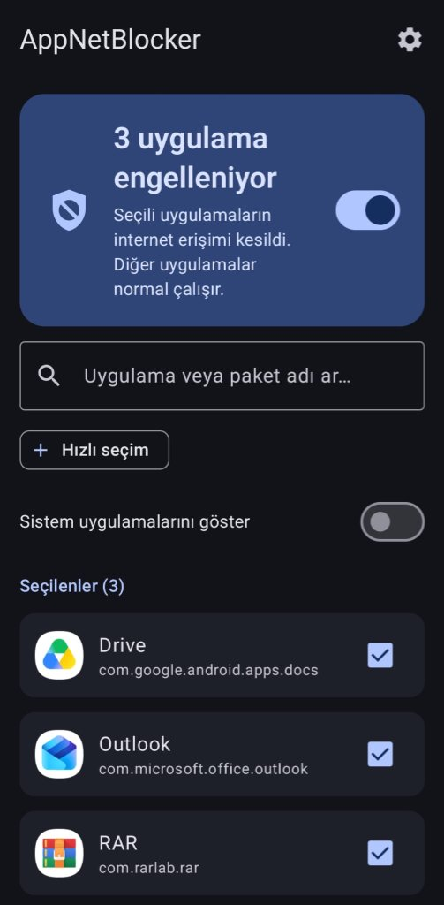
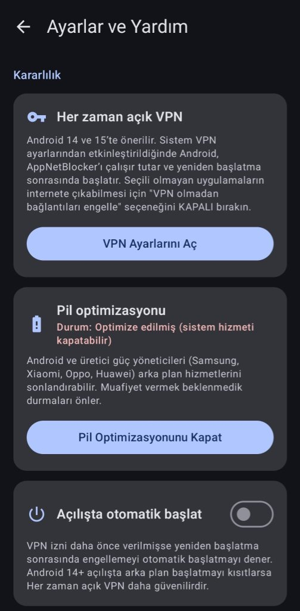
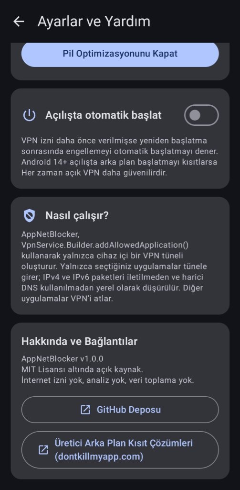

# AppNetBlocker

[](https://github.com/cihat-aslan/AppNetBlocker/actions/workflows/build.yml)
[](LICENSE)
-green.svg)


A minimal, open-source, no-root Android firewall app that blocks internet access for user-selected apps using Android's `VpnService` API.

Select one or more apps (such as an offline game that loads unwanted ads), flip the switch, and **only** the selected apps lose internet access while every other app on your phone continues working normally.

## Features

- **Per-app selective blocking**: Choose exact apps to block; all other apps keep normal Wi-Fi and mobile data access.
- **Local-only IPv4 + IPv6 blackhole**: Uses `VpnService.Builder` on your device with no external server and no forwarding DNS.
- **Fast app picker**: Real-time search by app name or package name, selected apps pinned to the top, **Quick pick** dialog by package ID, and a **Show system apps** toggle.
- **Reliability helpers**: Persistent foreground notification (`IMPORTANCE_MIN`) with quick **Stop** button, `START_STICKY` state restoration, optional **Auto-start on boot**, plus shortcuts for **Always-on VPN** and **Battery optimization** exemption.
- **Aware of edge cases**: Warns you if another VPN is active, if the OS stops/revokes the VPN, or if a selected app runs inside a work/dual profile.
- **Modern UI & localization**: Material 3 (Jetpack Compose) with light/dark + dynamic color themes, and full **English** and **Turkish** translations.

## Screenshots

| Main Screen | Settings — Reliability | Settings — How It Works & About |
| :---: | :---: | :---: |
|  |  |  |

## How It Works

AppNetBlocker creates a **local-only VPN tunnel** (`BlockerVpnService : VpnService`) on your device — no remote VPN server is involved and no packet ever leaves your phone:

1. **Per-app routing (`addAllowedApplication`)**: Only the package names you choose are added to `VpnService.Builder.addAllowedApplication(packageName)`. Every unselected app bypasses the tunnel and uses Wi-Fi / mobile data directly.
2. **IPv4 + IPv6 blackhole**: The tunnel assigns dummy local addresses (`10.0.0.2/32` and `fd00::2/128`), captures all IPv4 (`0.0.0.0/0`) and IPv6 (`::/0`) traffic from the selected apps, and omits forwarding DNS servers.
3. **Zero-copy local packet drop**: A background coroutine polls the non-blocking TUN file descriptor via `android.system.Os.poll()` (0% CPU when idle), reads incoming packets from blocked apps, and silently discards them without forwarding or logging.
4. **Empty-selection guard**: Android's `VpnService` routes *all* apps into a tunnel if no allowed apps are added. AppNetBlocker explicitly refuses to establish the tunnel if the resolved allowed-app set is empty, preventing accidental device-wide cutoffs.

## Build Instructions

### Prerequisites
- JDK 17
- Android SDK Platform 35 (`compileSdk = 35`, `minSdk = 26`, `targetSdk = 35`)

### Clone, Test & Build
```bash
git clone https://github.com/cihat-aslan/AppNetBlocker.git
cd AppNetBlocker

# Run unit tests
./gradlew testDebugUnitTest

# Build debug APK
./gradlew assembleDebug

# Run Android Lint checks
./gradlew lintDebug
```

The debug APK will be written to:
```
app/build/outputs/apk/debug/app-debug.apk
```

You can also download the latest CI-built debug APK artifact directly from [GitHub Actions](https://github.com/cihat-aslan/AppNetBlocker/actions/workflows/build.yml).

## Privacy

- **No `INTERNET` permission**: AppNetBlocker does **not** declare `android.permission.INTERNET` in its manifest. It is physically incapable of opening network sockets or sending data off-device.
- **No analytics, no ads, no tracking, no telemetry.**
- **Permissions explained**:
  - `BIND_VPN_SERVICE` (on service): Required by Android for `VpnService` apps.
  - `FOREGROUND_SERVICE` & `FOREGROUND_SERVICE_SPECIAL_USE`: Keeps the local VPN service alive reliably on Android 8–15 with a persistent notification.
  - `POST_NOTIFICATIONS`: Shows the ongoing status notification with a quick Stop button (Android 13+).
  - `RECEIVE_BOOT_COMPLETED`: Optional auto-start on boot when previously enabled.
  - `REQUEST_IGNORE_BATTERY_OPTIMIZATIONS`: Lets you open Android's battery-exemption prompt from Settings.
  - `ACCESS_NETWORK_STATE`: Detects locally if another VPN is already active so the app can warn you.
  - `QUERY_ALL_PACKAGES` / `<queries>`: Lists installed apps so you can pick which ones to block.
- **Clean-room MIT implementation**: Written completely from scratch with no code from NetGuard or GPL projects.

## Compatibility & Known Limitations

- **Cannot run alongside another VPN**: Android only allows one active `VpnService` at a time per user profile. Enabling AppNetBlocker will disconnect any other active VPN (and vice versa).
- **Work profiles, Dual Apps, and Secure Folder**: Android isolates VPN rules per user profile. Apps running inside a Work Profile, Samsung Secure Folder, Samsung Dual Messenger, Xiaomi Dual Apps, or similar cloned spaces may bypass a VPN running in your primary profile.
- **Aggressive OEM background killers**: Manufacturers such as Samsung, Xiaomi (MIUI/HyperOS), Huawei, Oppo, Realme, and Vivo frequently terminate background services even with a foreground notification. Use the **Settings & Help** screen in the app to disable battery optimization, and check [dontkillmyapp.com](https://dontkillmyapp.com/) for device-specific steps (e.g., Auto-start / Lock app in recents).
- **GrapheneOS / LineageOS / AOSP "Block connections without VPN"**: Do **not** enable Android's *"Block connections without VPN"* toggle inside system VPN settings when using AppNetBlocker. Because AppNetBlocker intentionally routes *only* selected apps into the tunnel via `addAllowedApplication()`, enabling that OS setting causes Android to block all unselected apps from accessing the internet.
- **Android 14 / 15 boot auto-start restrictions**: Android 14+ restricts starting certain foreground services directly from `BOOT_COMPLETED` receivers. Enabling **Always-on VPN** in Android's system VPN settings is the most reliable way to automatically keep or restore protection after a reboot.

## License

Licensed under the [MIT License](LICENSE).
